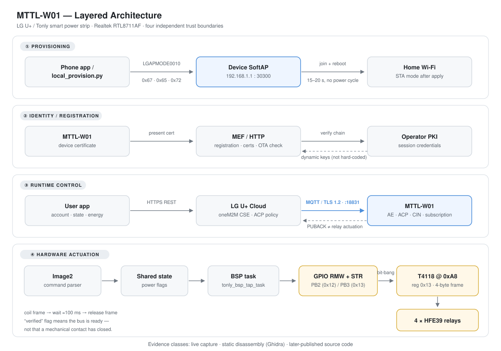
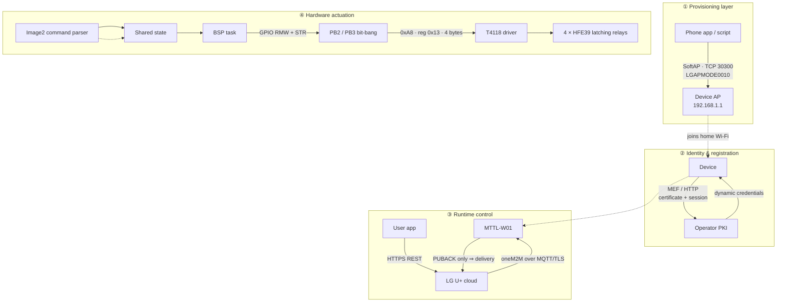
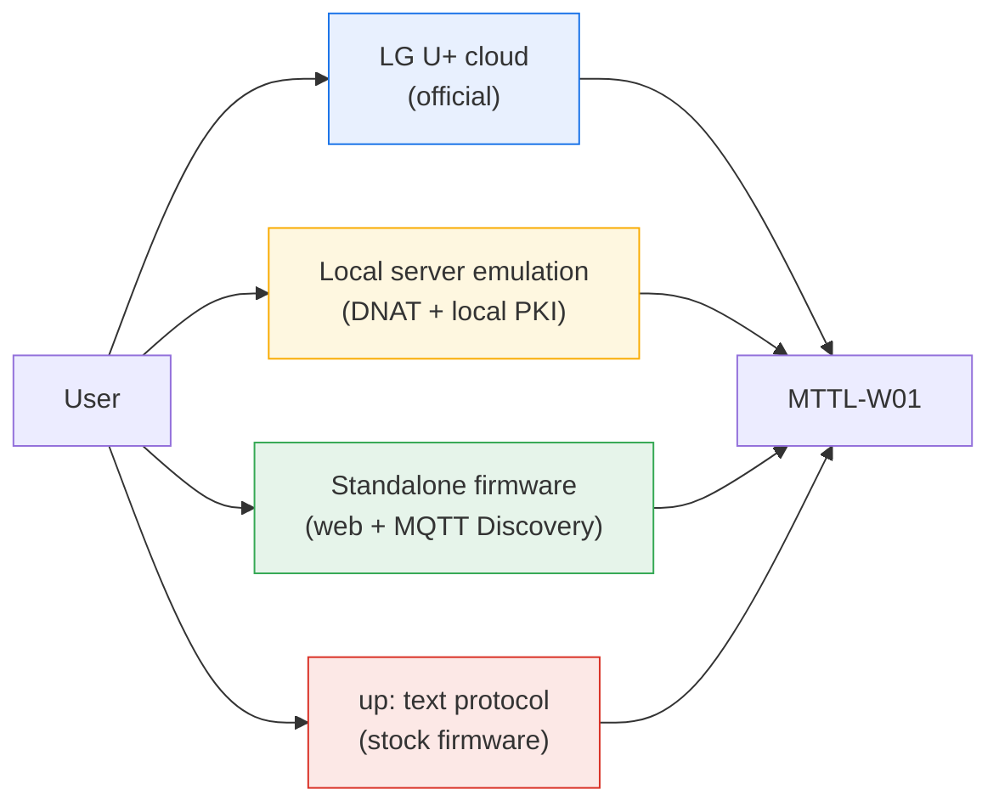
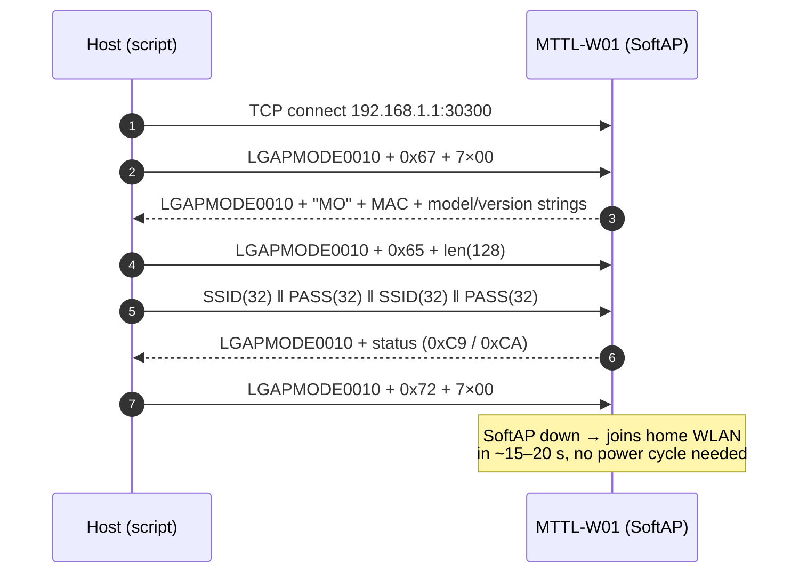
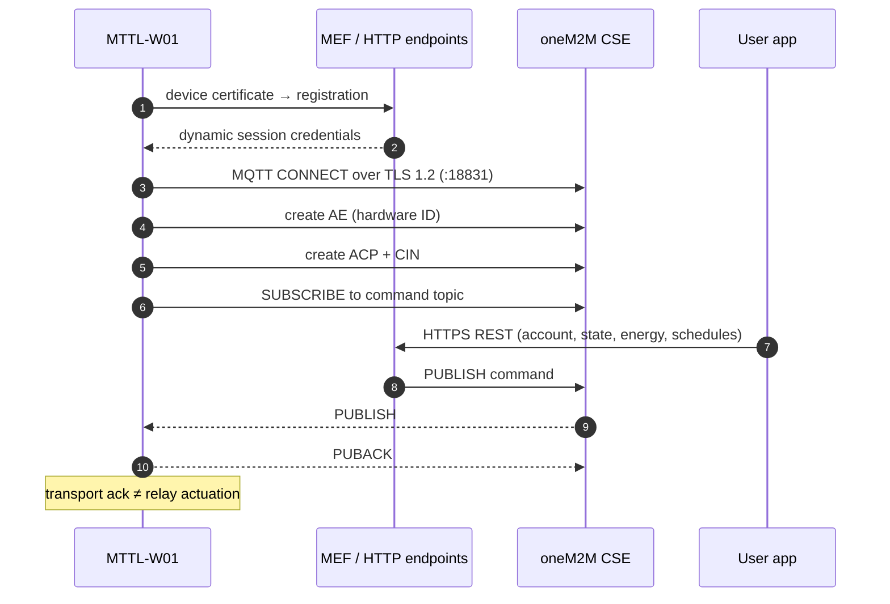
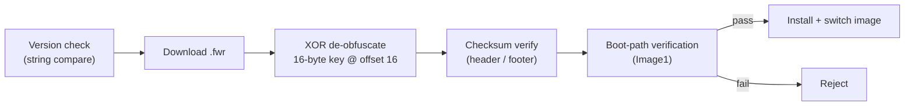
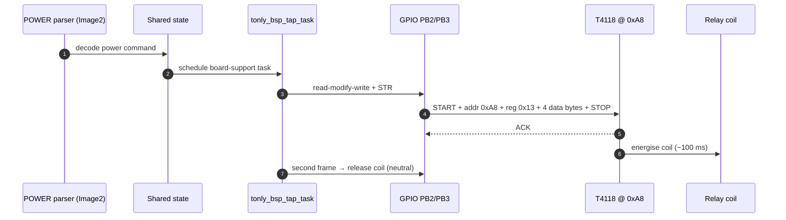
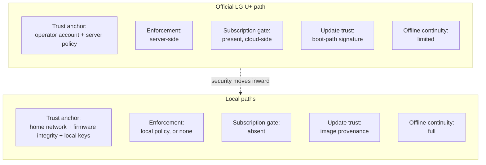
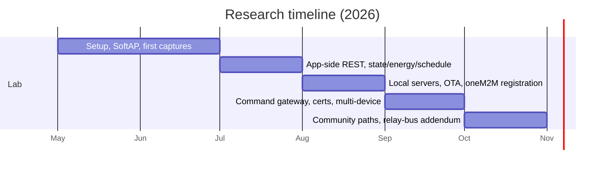

# MTTL-W01 Reverse Engineering

### Architecture & Protocol Analysis of the LG U+ Smart Power Strip

[](https://doi.org/10.5281/zenodo.23405440)
[](https://creativecommons.org/licenses/by/4.0/)
[](https://www.realtek.com/)
[](https://www.python.org/)
[]()

> A protocol-level reverse engineering study of the **MTTL-W01 "MULTITAP"** smart power strip
> (Tonly Technology / LG U+ ecosystem, Realtek **RTL8711AF**), comparing the trust model of the
> official LG U+ cloud path against three local control paths.

**Author:** Mohamed Eid Mohamed · **ORCID:** [0009-0007-5615-2854](https://orcid.org/0009-0007-5615-2854)
**Research period:** May – October 2026 · **Published:** 15 October 2026

---

## Table of contents

- [Why this repository](#why-this-repository)
- [Device at a glance](#device-at-a-glance)
- [System architecture](#system-architecture)
- [1 · Local provisioning (SoftAP + TCP 30300)](#1--local-provisioning-softap--tcp-30300)
- [2 · Cloud path (MEF / oneM2M / MQTT-TLS)](#2--cloud-path-mef--onem2m--mqtt-tls)
- [3 · OTA & firmware image format](#3--ota--firmware-image-format)
- [4 · Command path to the relays](#4--command-path-to-the-relays)
- [Security & trust model](#security--trust-model)
- [What is proven vs. inferred](#what-is-proven-vs-inferred)
- [Repository contents](#repository-contents)
- [Quick start — provisioning script](#quick-start--provisioning-script)
- [Methodology & tooling](#methodology--tooling)
- [Timeline](#timeline)
- [Citation](#citation)
- [Ethics, scope & licensing](#ethics-scope--licensing)
- [Related work](#related-work)

---

## Why this repository

Most consumer IoT teardowns stop at the PCB. This work goes further: it documents **what the firmware
actually speaks** — the provisioning protocol, the oneM2M resource tree, the MQTT topics, the OTA
obfuscation scheme, and the two-wire bus that finally moves the relay coils.

It is deliberately written as a **layered** analysis, so that every claim is tagged with its evidence
class: live packet capture, static disassembly, or later-published source code.

The single most important methodological result:

> **A successful `MQTT PUBACK` does not prove that a relay moved.**
> And a `STR` instruction writing to a GPIO register does not prove that a relay moved either —
> it was only the first byte of a bit-banged transaction on an external bus.

This repository is the companion to the thesis. It hosts the reference artefacts, the provisioning
tool, and the diagrams used throughout the paper.

---

## Device at a glance

| Field | Value |
|---|---|
| Model | **MTTL-W01** (MULTITAP) |
| Apparent manufacturer | Tonly Technology / LG U+ ecosystem |
| Type | 3.5 kW power strip — 4 independent outlets + energy metering + USB charging |
| SoC | **Realtek RTL8711AF** (Ameba1, ARM Cortex-M3) |
| Radio | 2.4 GHz 802.11 b/g/n, 1T1R |
| Reference firmware | `comMTTL-W01_1.0.66.fwr` — 327,944 bytes |
| SHA-256 | `d780b578af69d52f3a05191a8e7d91a20e05085a912722327481cd5663682c04` |
| Image header (16 B) | `f400050000600010ffffffffffffffff` |
| XOR key | `3f5a27e8d8fb85f9bd4d51196c4f5159` |
| Provisioning protocol | `LGAPMODE0010` over TCP **30300** |
| Cloud transport | MQTT over TLS 1.2 (port 18831) inside a oneM2M framework |
| Relay bus | 2-wire bit-banged, clock **PB2 (0x12)** / data **PB3 (0x13)** → address `0xA8`, register `0x13` |
| Notable strings | `MTTL-W01`, `MULTITAP`, `LGAPMODE0010`, `TONLY_TAP`, `LGU+-TAP-HW002`, `pool.ntp.org` |

---

## System architecture



The device is best understood as **four largely independent layers**. Each one has its own trust
boundary, its own failure modes, and its own attacker model.



### Control paths compared



---

## 1 · Local provisioning (SoftAP + TCP 30300)

After a factory reset the strip becomes a temporary access point and accepts configuration on a
single closed binary protocol.

**SSID / passphrase derivation:**

```
SSID  = "TONLY_TAP_" + code(MAC)
PASS  = "LGU_"       + code(MAC)
GW    = 192.168.1.1
PORT  = 30300
```

Because the WPA2 passphrase is **derived from the MAC address**, physical/radio proximity is the only
real barrier during the provisioning window. This is the weakest link in the whole product.

**Frame layout**

```
┌────────────────┬───────┬───────────────────────────┐
│ "LGAPMODE0010" │ cmd   │ payload (variable length) │
│   12 bytes     │ 1 B   │                           │
└────────────────┴───────┴───────────────────────────┘
```

| Cmd | Direction | Meaning | Notes |
|-----|-----------|---------|-------|
| `0x67` | host → dev | Request device info | Model, firmware version, MAC |
| `0x65` | host → dev | Announce data-block length | Length encoded in payload |
| —   | host → dev | Wi-Fi credential block | 32-byte SSID ‖ 32-byte password, repeated ×2 (128 B) |
| `0x72` | host → dev | Apply / reboot (`'r'`) | Device leaves SoftAP, joins home network |

**Status codes observed** on the confirmation frame: `0xC9`, `0xCA` → credentials accepted.



---

## 2 · Cloud path (MEF / oneM2M / MQTT-TLS)

Three interacting layers keep the device online:



**Key observations**

- Credentials are obtained **dynamically** from the MEF exchange; they are *not* hard-coded.
- All observed runtime traffic used **TLS 1.2**.
- The oneM2M resource tree (`AE`, `ACP`, `CIN`, subscriptions) must be created correctly — an MQTT
  connection alone does not make the device commandable.
- **Authorization lives on the server.** No per-command subscription check was found in the firmware.

---

## 3 · OTA & firmware image format



**Image1 / Image2 model (Ameba1)**

| Region | Contents | Notes |
|--------|----------|-------|
| **Image1** | Bootloader | Integrity/signature check of Image2, partition selection |
| **Image2** | Application | All protocol & control logic — what Ghidra can see |

Analysing only Image2 explains the *application* logic but **not** the boot policy. This is exactly why
modified images that passed internal checks were still rejected by stock devices.

**XOR obfuscation**

```python
key  = data[16:32]                    # 16-byte key embedded in the file
body = xor(data[32:], key * N)        # repeated-key XOR over the rest
```

The same key family worked across every image examined (1.0.66 and earlier experimental builds),
so the scheme is stable across versions.

> Practical note from the experiments: OTA installs of custom/community images **succeeded** when the
> original ports and endpoints expected by the stock firmware were preserved. Failures correlated with
> *externally altered* port numbers (MEF/OTA check port, local controller port).

---

## 4 · Command path to the relays

This is the part that is most often misread from disassembly.



**Why the naive reading is wrong**

The chain `POWER parser → shared state → BSP task → gpio_set → STR` looks like the final step.
It is not. The pins are a **two-wire, bit-banged bus**:

| Property | Value |
|---|---|
| Clock | PB2 (`0x12`) |
| Data | PB3 (`0x13`) |
| Target address | `0xA8` |
| Output register | `0x13` |
| Frame length | exactly **4 bytes** |
| Contents | outlet switch bits **and** indicator LED bits |
| Sequence | start → send → receive/ACK → stop (I²C-like) |
| Actuation | coil-activate frame, wait ≈100 ms, coil-release frame |

And critically — the `verified` flag returned by the hardware-port layer means **the bus interface is
ready**, not that a mechanical contact closed. The source comments say so explicitly.

---

## Security & trust model



| Dimension | LG U+ cloud | Server emulation | Standalone firmware | `up:` protocol |
|---|---|---|---|---|
| External account | Yes | No | No | No |
| Permissions decided by | Operator server | Home policy | Home policy | Essentially none |
| Setup complexity | Low (end user) | High | Medium | Low–medium |
| Modified image needed | No | Sometimes | Yes | No |
| Main threat surface | Account / cloud | LAN keys + certs | Firmware source + LAN | Open LAN |
| Works offline | No | Yes | Yes | Yes |

**Threat model (condensed)**

| Surface | Risk | Reason |
|---|---|---|
| SoftAP during provisioning | Medium–high (in range) | MAC-derived WPA2 passphrase |
| MQTT/TLS after registration | Depends on certs/keys | Server-centric on official path |
| Forged OTA image | Low–medium vs. stock | Boot signature limits arbitrary code |
| Local web / `up:` interface | High if exposed beyond LAN | Designed for a trusted network |
| Energy telemetry | Medium (privacy) | Occupancy patterns leak to cloud |

---

## What is proven vs. inferred

Honest evidence tagging is the backbone of this work.

| Claim | Status |
|---|---|
| SoftAP + `LGAPMODE0010` structure on TCP 30300 | ✅ Proven — live captures + working script |
| REST (app) is separate from the device channel | ✅ Proven |
| oneM2M/MQTT registration components & topic subscriptions | ✅ Proven |
| `PUBACK` ≠ hardware actuation | ✅ Proven — repeated in testing |
| FWR layout, XOR obfuscation, 1.0.66 size & hash | ✅ Proven |
| Image2-only analysis misses boot policy | ✅ Proven by design + failures |
| Subscription/permission logic is server-side | ✅ Strongly supported by static analysis |
| PB2/PB3 → `0xA8` / `0x13`, 4-byte frame with outlet+LED bits | ✅ From published local-path source |
| That bus path is enabled in **all production builds** | ⚠️ Not proven — guarded by compile-time flags |
| Identical bit maps in stock 1.0.66 Image2 | ⚠️ Not proven — needs binary/live comparison |
| `verified` == mechanical contact confirmation | ❌ Explicitly rejected by source comments |
| Relay activation from a fully reconstructed MQTT command on a third-party cloud | ❌ Not achieved within scope |
| Boot signature broken | ❌ Out of scope, not attempted |

---

## Repository contents

```
.
├── README.md                                          ← this file
├── architecture.svg                                   ← layered architecture diagram
├── MTTL-W01_Reverse_Engineering_Thesis_EN_v1_final.pdf ← full thesis (13 pp.)
├── local_provision.py                                 ← SoftAP provisioning tool (documented)
├── comMTTL-W01_1.0.66.fwr                             ← reference stock firmware (see NOTICE)
└── NOTICE.md                                          ← licensing & ownership of the firmware image
```

| File | Size | Purpose |
|---|---|---|
| `MTTL-W01_Reverse_Engineering_Thesis_EN_v1_final.pdf` | 401 KB | Full written analysis |
| `local_provision.py` | 5.7 KB | Automates `LGAPMODE0010` provisioning end-to-end |
| `comMTTL-W01_1.0.66.fwr` | 327 KB | Reference image for hash/XOR verification |
| `architecture.svg` | — | Vector diagram used in the thesis pipeline |

---

## Quick start — provisioning script

> ⚠️ **Only run this against a device you own.** It configures the strip to join *your* Wi-Fi.

```bash
git clone https://github.com/gomgom-40/mttl-w01-reverse-engineering.git
cd mttl-w01-reverse-engineering
```

1. Factory-reset the strip and join the **`TONLY_TAP_xxxx`** access point
   (passphrase `LGU_xxxx`, where `xxxx` derives from the MAC).
2. Edit the `CONFIG` block in `local_provision.py`:

```python
CONFIG = {
    "device_ap_ip": "192.168.1.1",
    "device_ap_port": 30300,
    "home_wifi_ssid": "YOUR_WIFI_SSID",
    "home_wifi_password": "YOUR_WIFI_PASSWORD",   # ≥ 8 chars
}
```

3. Run it:

```bash
python local_provision.py
```

Expected flow:

```
[*] Connection attempt (1/3) to 192.168.1.1:30300...
[+] TCP connection established
[*] Sending device information request (0x67)...
[<] Parsed data: {'mac': '...', 'parts': [...]}
[*] Announcing 128 bytes of Wi-Fi data (0x65)...
[*] Sending Wi-Fi credentials (SSID: ...)
[<] Status code: 0xc9
[+] Wi-Fi credentials accepted successfully!
[*] Sending apply and reboot command (0x72)...
[+] Transmission complete.
```

No dependencies — standard library only.

---

## Methodology & tooling

| Tool | Used for |
|---|---|
| Wireshark | SoftAP, TLS and MQTT capture |
| Frida + Android emulation | Intercepting the mobile-app path |
| mitmproxy / controlled TLS proxy | REST study from the app side |
| Ghidra | Image2 disassembly, function tracing, strings |
| Python | Experimental MEF/HTTP, MQTT, OTA and control servers |
| OpenSSL | Certificate inspection and PEM chain handling |
| Custom XOR tooling | FWR de-obfuscation and string extraction |

**Three rules that shaped the work**

1. Separate what is **captured**, what is **disassembled**, and what is **read from later source**.
2. Never treat transport success as application or hardware success.
3. Document failures with the same rigour as successes.

---

## Timeline



| Period | Main activity |
|---|---|
| May–June 2026 | Laboratory setup, SoftAP, first captures |
| July 2026 | REST from the app side; state / energy / schedule paths |
| August 2026 | Local servers, OTA, oneM2M registration; first analytical closure |
| September 2026 | Command gateway, certificates, multi-device paths |
| October 2026 | Community local paths, standalone source, relay-bus addendum, thesis |

---

## Citation

If this work is useful to you, please cite it:

```bibtex
@misc{mohamed2026mttlw01,
  author       = {Mohamed, Mohamed Eid},
  title        = {Reverse Engineering of the Architecture and Protocols of the
                  MTTL-W01 Smart Power Strip: A Methodological Comparison Between
                  Official Cloud Control (LG U+) and Local Control Paths},
  year         = {2026},
  month        = {oct},
  publisher    = {Zenodo},
  version      = {v1},
  doi          = {10.5281/zenodo.23405440},
  url          = {https://doi.org/10.5281/zenodo.23405440}
}
```

**Plain text:** Mohamed Eid Mohamed, *Reverse Engineering of the Architecture and Protocols of the
MTTL-W01 Smart Power Strip*, Zenodo, v1, 2026. doi:10.5281/zenodo.23405440

---

## Ethics, scope & licensing

- All experiments were performed **exclusively on devices owned by the researcher**.
- **No third-party infrastructure identifiers** are published; operator endpoints are described
  generically.
- The work does **not** provide tooling to attack third-party accounts or services.
- No vendor report was filed: the device is obsolete and no longer sold by LG U+.
- AI tools were used **only** for language polishing and formatting; research design, experiments,
  analysis and conclusions are the author's own.

| Component | License |
|---|---|
| Thesis (PDF), `README.md`, `architecture.svg`, `local_provision.py` | **CC BY 4.0** |
| `comMTTL-W01_1.0.66.fwr` (stock firmware) | **Not** CC BY — property of its original rights holder, included **solely for verification**. See [`NOTICE.md`](NOTICE.md). |

---

## Related work

- **[Hackaday: LG Smart Power Plug MTTL-W01](https://hackaday.io/project/202043-lg-smart-power-plug-mttl-w01)** — by *mwahid*.
  Excellent hardware-side teardown: board identification, the three I²C buses, logic-analyzer captures
  of the relay frames, and an ESP-01 retrofit. **This repository complements that work** by covering
  the network protocols, oneM2M resource model, OTA pipeline and trust comparison.
- **Community local-control projects** — `af950833/mttl_w01` (local server) and
  `af950833/mttl_w01_standalone` (standalone firmware), referenced in the thesis.
- **`ttaengz/mttl-w01-matterbridge`** — MatterBridge using the `up:` text protocol on stock firmware.

---

## Future work

- Capture a complete official control command sequence with **synchronised relay measurements**.
- Characterise PB2/PB3 bus behaviour on the **original 1.0.66** firmware.
- Byte-level binary comparison between stock and local-path images.
- SoftAP behaviour across a wider device sample.
- Stronger authentication for standalone firmware **within RAM/ROM constraints**.

---

<p align="center">
  <sub>Independent research · Not affiliated with LG U+, Tonly Technology or Realtek.</sub><br/>
  <sub>MTTL-W01 is a product name of its respective owner and is used here for identification only.</sub>
</p>
